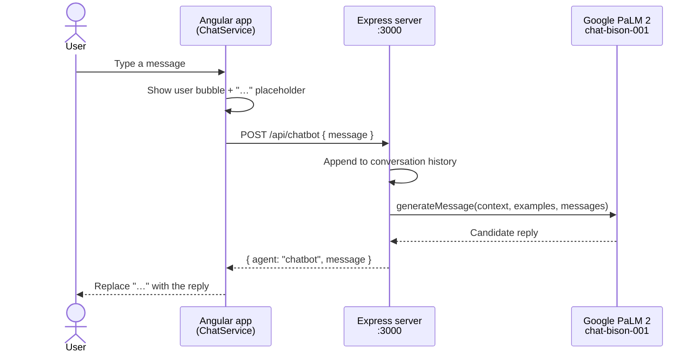

<div align="center">

# 🌴 PaLM Chatbot

**A conversational AI chatbot built with Angular Material on the front and an Express server talking to Google's PaLM 2 (`chat-bison-001`) model on the back.**

[](https://palm-chatbot.vercel.app)


[Features](#-features) · [Architecture](#%EF%B8%8F-architecture) · [Getting Started](#-getting-started) · [Customise](#-customise-the-bot) · [Structure](#-project-structure)

</div>

---

> [!NOTE]
> Google has since retired the PaLM API in favour of Gemini. The code here is kept as a reference for building an Angular ↔ LLM chat app; to run it today, swap the `DiscussServiceClient` call in `server/index.js` for the Gemini SDK (`@google/generative-ai`).

## ✨ Features

- 💬 **Chat-style UI** with user and bot message bubbles (Angular Material cards)
- ⏳ **Typing indicator** — a "…" placeholder while the model is thinking
- 🧠 **Conversation memory** — the server sends the full message history with every request
- 🎭 **Prompt context & few-shot examples** to steer the bot's tone
- ↩️ **Line-break pipe** so multi-paragraph answers render nicely
- 🧩 Standalone components (no NgModules)

## 🏗️ Architecture



## 🚀 Getting Started

### Prerequisites

- Node.js 18+
- Angular CLI: `npm install -g @angular/cli`
- A Google AI API key

<details open>
<summary><b>1️⃣ Server (<code>server/</code>)</b></summary>

```bash
cd server
npm install
npm install cors          # used by index.js
echo "API_KEY=your_google_ai_key" > .env
npm start                 # http://localhost:3000
```

</details>

<details open>
<summary><b>2️⃣ Angular app (repo root)</b></summary>

```bash
npm install
ng serve                  # http://localhost:4200
```

The app calls `http://localhost:3000/api/chatbot` (see [`src/app/chat.service.ts`](src/app/chat.service.ts)).

</details>

## 🎨 Customise the bot

<details>
<summary><b>Change its personality</b></summary>

In [`server/index.js`](server/index.js):

```js
const CONTEXT = "Respond to all questions with atleast 300 words";

const EXAMPLES = [
  {
    input:  { content: "What is the capital of California?" },
    output: { content: "If the capital of California is what you seek,\nSacramento is where you ought to peek." },
  },
];
```

Edit `CONTEXT` for the system-style instruction and `EXAMPLES` for few-shot demonstrations of the tone you want.

</details>

## 📁 Project Structure

<details>
<summary><b>Expand tree</b></summary>

```text
Palm-Chatbot/
├── src/app/
│   ├── app.component.*          # chat UI
│   ├── chat.service.ts          # HTTP call to the server
│   ├── chat-content.interface.ts
│   └── line-break.pipe.ts
└── server/
    └── index.js                 # Express + PaLM DiscussServiceClient
```

</details>

---

<div align="center">

Built by **[Shariq](https://github.com/Shariq2003)** · [LinkedIn](https://www.linkedin.com/in/shariq-sd)

⭐ If you like this project, consider giving it a star!

</div>
